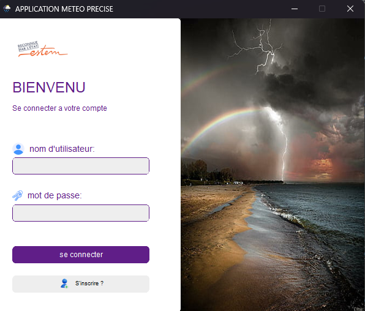
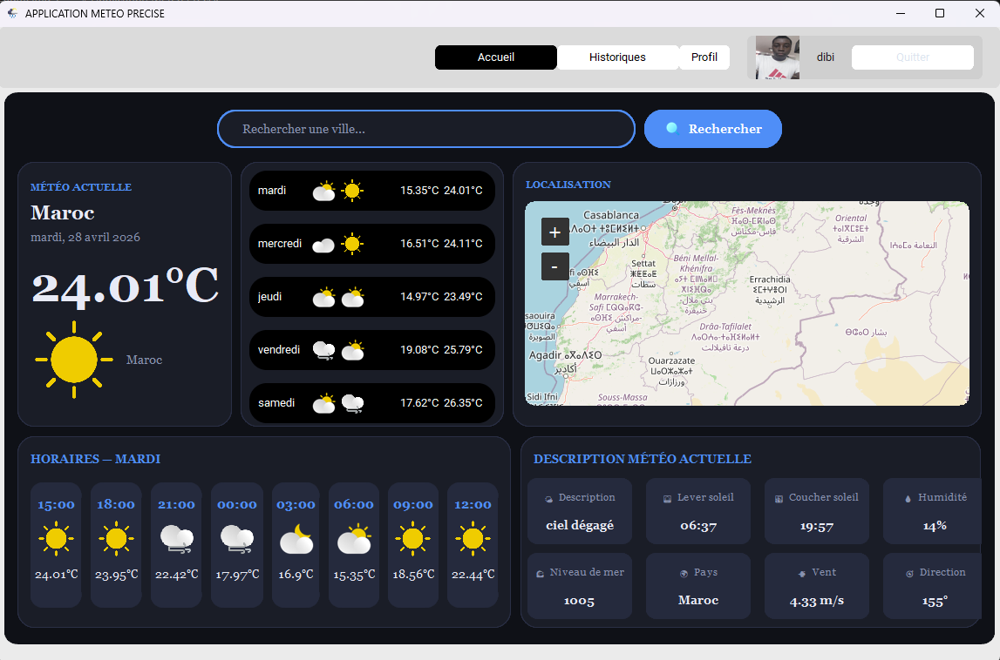
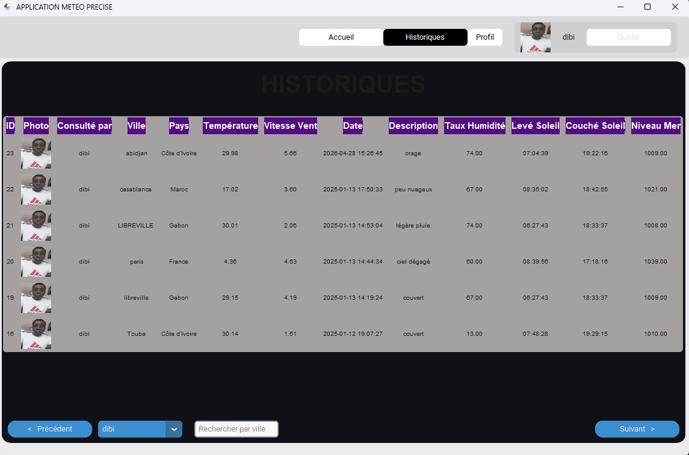
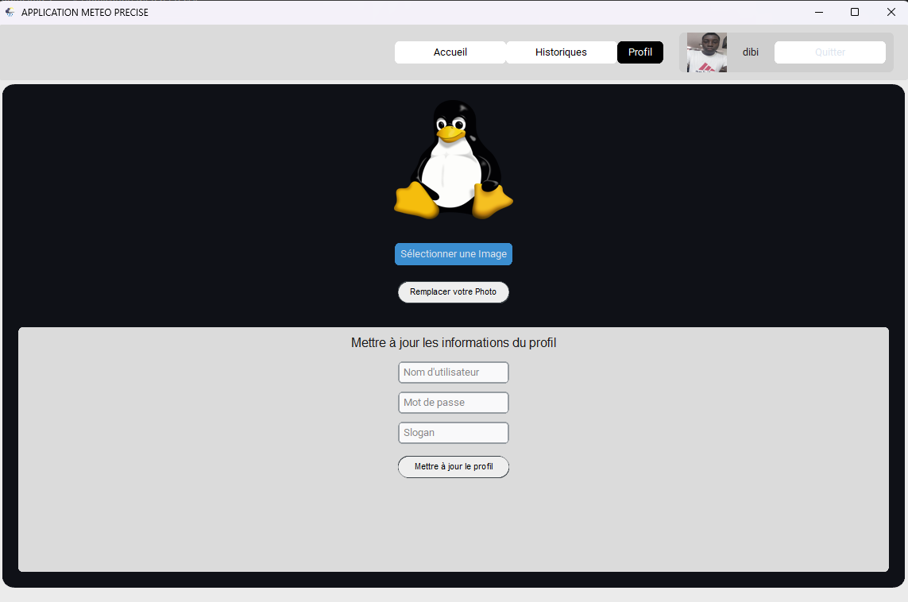

# Application Meteo Precise

Une application de bureau developpee en Python permettant de consulter la meteo en temps reel, de gerer un historique de consultations et de personnaliser son profil utilisateur.

---

==

---

## Table des matieres

- [Application Meteo Precise](#application-meteo-precise)
  - [Table des matieres](#table-des-matieres)
  - [Apercu](#apercu)
  - [Fonctionnalites](#fonctionnalites)
  - [Structure du projet](#structure-du-projet)
  - [Prerequis](#prerequis)
  - [Installation](#installation)
  - [Utilisation](#utilisation)
  - [Base de donnees](#base-de-donnees)
  - [Contribuer](#contribuer)
  - [Licence](#licence)

---

## Apercu

Cette application de bureau offre une interface graphique moderne pour consulter la meteo de n'importe quelle ville dans le monde. Elle integre un systeme de comptes utilisateurs, un historique des consultations et une page de gestion de profil.

---



---

## Fonctionnalites

- Authentification utilisateur avec creation de compte (nom d'utilisateur, mot de passe, slogan, photo de profil)
- Consultation meteo en temps reel avec affichage de la temperature, vitesse du vent, taux d'humidite, heure de lever et de coucher du soleil, et niveau de la mer
- Historique des consultations avec pagination (6 entrees par page) et filtres par ville
- Gestion du profil : modification du nom d'utilisateur, du mot de passe, du slogan et de la photo de profil
- Interface graphique moderne avec CustomTkinter

---



---

## Structure du projet

```
PROJET PY/
├── accessoires/
│   ├── grille/             Icones utilisees dans le tableau meteo
│   ├── icones_menu/        Icones du menu de navigation
│   ├── indentification/
│   │   ├── icones/         Images de l'interface de connexion
│   │   └── utilisateurs/   Photos de profil des utilisateurs (generees automatiquement)
│   ├── json/               Fichier de reference des pays
│   ├── logo/               Logo de l'application
│   └── meteo_hebdo/        Icones des conditions meteorologiques
├── db/
│   └── BASE_DE_DONNEES.db  Base de donnees SQLite
├── accueil.py              Page d'accueil et consultation meteo
├── connections.py          Gestion de la connexion et de l'inscription
├── historiques.py          Page de l'historique des consultations
├── main.py                 Point d'entree de l'application
├── outils.py               Fonctions utilitaires et connexion a la base de donnees
├── profil.py               Page de gestion du profil utilisateur
└── requis.txt              Liste des dependances Python
```

## Prerequis

- Python 3.8 ou superieur
- Les bibliotheques listees dans `requis.txt`

Les principales dependances sont :

- customtkinter
- Pillow
- sqlite3 (inclus dans la bibliotheque standard Python)

## Installation

1. Clonez le depot sur votre machine :

```
git clone https://github.com/votre-utilisateur/votre-depot.git
cd votre-depot
```

2. Installez les dependances :

```
pip install -r requis.txt
```

3. Lancez l'application :

```
python main.py
```

---



---

## Utilisation

**Premiere connexion**

Au premier lancement, cliquez sur le bouton "S'inscrire" pour creer votre compte. Renseignez un nom d'utilisateur, un mot de passe, un slogan unique (qui sert aussi d'identifiant interne) et chargez une photo de profil.

**Navigation**

Une fois connecte, trois sections sont accessibles depuis le menu superieur :

- Accueil : recherchez la meteo d'une ville et consultez les informations en temps reel.
- Historiques : retrouvez toutes vos consultations passees, filtrez par ville et naviguez entre les pages.
- Profil : modifiez vos informations personnelles et changez votre photo de profil.

## Base de donnees

L'application utilise une base de donnees SQLite situee dans le dossier `db/`. Elle contient les tables suivantes :

- `utilisateurs` : comptes utilisateurs (identifiant, nom, mot de passe, slogan, photo, date de creation)
- `info_meteo` : historique des consultations meteo (ville, pays, temperature, vent, humidite, etc.)
- `tab_pays` : reference des pays avec leurs codes et noms

Le fichier `BASE_DE_DONNEES.sqbpro` est un fichier de projet pour le logiciel DB Browser for SQLite, utile pour inspecter la base manuellement.

## Contribuer

Les contributions sont les bienvenues. Pour proposer une amelioration :

1. Forkez le projet
2. Creez une branche pour votre fonctionnalite
3. Soumettez une Pull Request en decrivant vos changements

## Licence

Ce projet est distribue sous licence MIT. Consultez le fichier `LICENSE` pour plus de details.